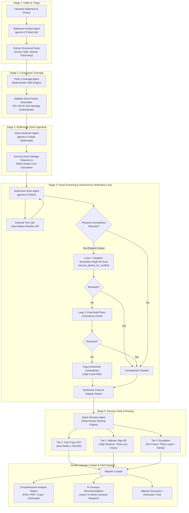

# Spark FNOL — Agentic AI Insurance Claims Triage

> **Autonomous multi-agent First Notice of Loss (FNOL) claims triage engine featuring multimodal damage appraisal, contractual policy gating, automated fraud consistency screening, and AI-powered surveyor management.**

[](https://fastapi.tiangolo.com)
[](https://ai.google.dev)
[](https://crewai.com)
[](https://open-meteo.com)
[](https://python.org)
[](LICENSE)

---

### 🏆 Hackathon Context — Aerophilia 2026

* **Track:** **Claims Triage Agent (Insurance)**
* **Target Objective:** Build an agentic system that reads claim submissions, evaluates damage severity, verifies policy coverage, screens fraud/inconsistencies, and routes claims to the appropriate human adjuster or field surveyor.
* **Submission Asset:** 🎥 **[Watch the 2–3 Minute Walkthrough Demo Video](https://youtu.be/placeholder-demo-video)** *(Replace with final video URL)*

---

## 📑 Table of Contents

- [Overview & Solution](#overview--solution)
- [Problem Statement](#problem-statement)
- [Key Features](#key-features)
- [Agentic AI Architecture](#agentic-ai-architecture)
  - [Observe → Plan → Act → Observe → Re-evaluate Cycle](#observe--plan--act--observe--re-evaluate-cycle)
  - [Specialized AI Agents & Roles](#specialized-ai-agents--roles)
  - [Architecture & Pipeline Flow Diagram](#architecture--pipeline-flow-diagram)
  - [Why Spark FNOL is Genuinely Agentic](#why-spark-fnol-is-genuinely-agentic)
- [Deterministic Gating & Tier Routing](#deterministic-gating--tier-routing)
- [External Tools & APIs](#external-tools--apis)
- [Technology Stack](#technology-stack)
- [Project Architecture & Directory Structure](#project-architecture--directory-structure)
- [Data Sources & Policy Verification](#data-sources--policy-verification)
- [How to Run Locally](#how-to-run-locally)
- [Benchmark Test Scenarios](#benchmark-test-scenarios)
- [Example Claim Walkthrough](#example-claim-walkthrough)
- [Demonstration & Judging Guide](#demonstration--judging-guide)
- [Limitations & Responsible AI](#limitations--responsible-ai)
- [AI Coding Assistant Disclosure](#ai-coding-assistant-disclosure)
- [Team & Credits](#team--credits)

---

## 💡 Overview & Solution

In automotive insurance, the **First Notice of Loss (FNOL)** is the critical moment of truth for policyholders. However, conventional triage workflows rely on manual document indexing, back-and-forth phone questionnaires, delayed physical inspections, and subjective desk reviews.

**Spark FNOL** is an enterprise-grade, agentic insurance claims triage engine. It transforms raw, unstructured claim submissions (free-text claimant statements and uploaded damage photographs) into structured, evidence-backed assessments and actionable recommendations for human claims adjusters.

### The Spark Solution Framework

Spark FNOL strictly bifurcates **Probabilistic AI Cognition** from **Deterministic Contractual Governance**:

1. **Multimodal AI Cognition:** Autonomous agents parse raw claimant narratives into structured facts, inspect damage photos zone-by-zone (bumper, hood, fender, headlight, underbody), evaluate damage severity, and compare claimed physics against photographic visual signatures.
2. **Deterministic Rules & Gating:** Mathematical calculations (deductibles, IDV ceilings, depreciation, repair cost thresholds) and policy contract enforcement (inception/expiry dates, own-damage vs. third-party exclusions) are executed purely in deterministic Python logic to prevent hallucinated financial payouts.
3. **Autonomous Verification Loops:** When discrepancies emerge between narrative statements and visual damage patterns, the Supervisor Agent initiates targeted secondary re-scans and queries live meteorological radar to resolve contradictions before gating.
4. **Human-in-the-Loop (HITL) Governance:** High-stakes decisions (authorizing settlements, rejecting claims, or returning for clarification) remain under human adjuster control, supported by comprehensive audit dossiers and recommended surveyor assignments.

---

## ⚠️ Problem Statement

Conventional motor insurance claim processing faces critical systemic bottlenecks:

* **Manual Review Bottlenecks:** Human adjusters must read through lengthy, subjective claimant statements and cross-reference them against complex, multi-page policy schedules.
* **Delays in Initial Damage Assessment:** Coordinating initial physical vehicle inspections can take several days to weeks, increasing cycle times and rental car costs.
* **Contractual Verification Pitfalls:** Overlooking policy lapse dates, endorsement gaps (such as missing Zero-Depreciation riders), or fundamental coverage exclusions (e.g., Own Damage claims filed under Third-Party Only policies).
* **Undetected Fraud & Contradictions:** Subtly fabricated claims (e.g., claiming a head-on animal collision when photos only show tire/fender scraping, or falsely blaming heavy rain during a clear day) frequently pass initial intake unnoticed.
* **Suboptimal Field Dispatch:** Routing minor dents to senior loss appraisers or high-value complex structural total losses to junior surveyors wastes valuable technical resources.

---

## ⚡ Key Features

| Category | Implemented Feature | Description |
| :--- | :--- | :--- |
| **Claim Intake** | **Dynamic FNOL Intake Portal** | Accepts arbitrary new claimant statements and uploaded damage photos without requiring pre-existing database records. |
| **Claim Intake** | **1-Click Benchmark Feeder** | Instant scenario feeder populating 7 canonical edge cases covering Fast-Track, Total Loss, Fraud, Self-Correction, and Coverage Gaps. |
| **AI Assessment** | **Multimodal Vision Appraisal** | Evaluates vehicle damage zone-by-zone using Google Gemini 2.5 Multimodal Vision, generating neutral severity ratings. |
| **AI Assessment** | **Prompt-Injection Defended NLP** | Extracts claimed impact zones, dates, injuries, and liability from claimant statements while sanitizing adversarial inputs. |
| **Contract Gating** | **Deterministic Policy Verification** | Cross-checks policy schedules (`db2_policies.json`) for active date windows, vehicle registration, deductible, IDV, and clause citations. |
| **Fraud Screening** | **Physical & Environmental Consistency** | Detects statement vs. photo discrepancies and queries real historical weather records via Open-Meteo. |
| **Agentic Loop** | **Self-Correction Verification Loops** | Executes up to 2 autonomous re-scan iterations when claimed damage zones contradict observed photographic evidence. |
| **Decision Engine** | **Deterministic 3-Tier Router** | Classifies claims into Tier 1 (Fast-Track STP), Tier 2 (Human Sign-off), or Tier 3 (SIU/Adjuster Escalation). |
| **Cockpit UI** | **Live Adjuster Cockpit (SPA)** | Real-time Kanban pipeline view, HUD operational metrics, step-by-step and auto-step execution controls, and interactive chat. |
| **Cockpit UI** | **Smart Claim Filters** | 4 instant horizontal filters: `All Claims`, `⚡ High Severity`, `🚨 Fraud Signals`, and `⚠️ Ambiguous`. |
| **Reporting** | **Inline Analysis Report Dossier** | Expandable 5-section dossier (Sections A–E) with 1-click `Print`, `Save as PDF`, `Copy Text` (with feedback), `Download`, and `Close`. |
| **Surveyor Mgmt** | **AI Surveyor Recommendation** | Recommends `Junior Surveyor` vs. `Senior Surveyor` with a 2–3 sentence rationale based on cost (> ₹30k), severity, fraud, and injury. |
| **Surveyor Mgmt** | **Field Surveyor Roster & Dispatch** | Dedicated Surveyor view tracking capacity, active caseloads, reassignment controls, and physical inspection notes. |

---

## 🧠 Agentic AI Architecture

### Observe → Plan → Act → Observe → Re-evaluate Cycle

Spark FNOL is built on an explicit **ReAct / Autonomous Verification Loop** pattern, orchestrated across 5 sequential stages:



---

### Specialized AI Agents & Roles

Spark FNOL deploys specialized agents with isolated responsibilities, preventing context contamination:

#### 1. Statement Analyst Specialist
* **Model:** `gemini-2.5-flash-lite`
* **Role:** Intake natural language processing and fact extraction.
* **Responsibilities:** Parses unstructured claimant loss descriptions into structured `StatementFacts` models (impact locations, date/time, injuries, third-party involvements). Defends against prompt injection and jailbreak attempts by discarding meta-instructions in claimant submissions.
* **Tool:** `extract_statement_facts`

#### 2. Policy & Coverage Specialist
* **Model:** `gemini-2.5-flash-lite` + Deterministic Contract Engine
* **Role:** Contractual schedule verification and clause enforcement.
* **Responsibilities:** Validates coverage strictly against `data/db2_policies.json`. Checks effective/expiry dates against loss date, verifies vehicle registration match, identifies Own Damage (OD) vs. Third-Party (TP) limitations, computes deductibles, and cites exact policy clauses.
* **Tool:** `verify_policy_coverage_deterministic`

#### 3. Vision Assessor Specialist
* **Model:** `gemini-2.5-flash` (Multimodal Vision)
* **Role:** Neutral, objective vehicle damage inspection.
* **Responsibilities:** Conducts pixel-level inspection of vehicle photographs using an objective zone checklist (Front, Rear, Left Side, Right Side, Roof/Windshield, Corners, Underbody). Assigns severity ratings and maps damaged components to standardized Indian automotive repair cost tables (`data/repair_costs.json`).
* **Tool:** `analyze_photos_neutral`

#### 4. Supervisor Brain & Verification Loop Orchestrator
* **Model:** `gemini-2.5-flash`
* **Role:** Multi-signal reconciliation, loop orchestration, and fraud risk screening.
* **Responsibilities:** Compares claimant narrative statements against visual damage patterns. Invokes the Open-Meteo API to corroborate reported weather conditions. Orchestrates targeted re-scan verification loops when contradictions occur.
* **Tools:** `evaluate_fraud_and_consistency`, `rescan_photos_for_conflict`, `verify_weather_open_meteo`

#### 5. Spark Decision Agent
* **Implementation:** Pure Deterministic Python (`decision_gate.py`)
* **Role:** Final financial and procedural triage routing.
* **Responsibilities:** Evaluates combined pipeline outputs top-down. Assigns final claim tiers, sets claim statuses, computes net payable indemnities, generates rationale bullet points, and structures referenced evidence packages.

#### 6. AI Surveyor Recommendation Engine
* **Implementation:** Heuristic Expertise Matching Agent (`agents_crew.py`)
* **Role:** Automated field surveyor expertise dispatch.
* **Responsibilities:** Recommends `Junior Surveyor` vs. `Senior Surveyor` with a concise, claim-specific rationale evaluating 5 critical risk dimensions:
  * Damage Severity classification
  * Estimated Repair Cost (> ₹30,000 threshold for Senior oversight)
  * Photographic statement-vs-evidence discrepancy
  * Image clarity and remote sufficiency
  * Bodily injury or third-party property liability involvement

---

### Why Spark FNOL is Genuinely Agentic

| Dimension | Conventional Script / Prompt Chain | Spark FNOL Agentic System |
| :--- | :--- | :--- |
| **Workflow Path** | Fixed linear prompt sequence ($A \to B \to C$). | **Dynamic state-driven progression** advancing through discrete Kanban stages with conditional branching. |
| **Sensory Grounding** | Text-only hallucinations based on claimant input. | **Multimodal vision perception** paired with **live external meteorological satellite calls**. |
| **Conflict Resolution** | Accepts statement as ground truth. | **Autonomous 2-loop re-verification** (`Observe → Plan → Act → Re-evaluate`) to confirm or refute discrepancies. |
| **Financial Security** | LLMs calculate dollar amounts directly. | **Deterministic mathematical gating**; LLM identifies damage type, Python code calculates payable amounts. |
| **Governance** | Unchecked automated decisions. | **Full Human-in-the-Loop Cockpit** with granular execution, dismissal, and clarification controls. |

---

## ⚖️ Deterministic Gating & Tier Routing

The Decision Gate (`decision_gate.py`) evaluates claims top-down using strict priority ordering:

```
Case 1: Fraud / High Risk / Unresolved Contradiction
   └── Final Tier: Tier 3 (Escalation) → Status: STUCK → Action: ESCALATION (SIU Review)

Case 2: Coverage Failure (Lapsed Policy / OD on TP-Only / Unmatched Reg)
   └── Final Tier: Tier 3 (Coverage Gate) → Status: STUCK → Action: ESCALATION (Coverage Denial)

Case 3: Incomplete or Low-Confidence Evidence (Missing Photos / Unusable / Conf < 80%)
   └── Final Tier: Tier 2 (Information Request) → Status: NEEDS ATTENTION → Action: REQUEST (Return to Claimant)

Case 4: Moderate/Severe Damage / High Reserve (> ₹25k) / Total Loss (≥ 75% IDV) / Injury
   └── Final Tier: Tier 2 (Adjuster Sign-Off) → Status: NEEDS ATTENTION → Action: RECOMMENDATION

Case 5: Minor Damage (≤ ₹25k) + Active Policy + Low Fraud Risk + High Confidence
   └── Final Tier: Tier 1 (Fast-Track STP) → Status: IN PROGRESS → Action: RECOMMENDATION (Instant Payout)
```

---

## 🌐 External Tools & APIs

Spark FNOL integrates external tools compliant with the hackathon's multi-agent tool execution criteria:

### 1. Open-Meteo Historical & Forecast Weather API
* **Provider:** [Open-Meteo](https://open-meteo.com) (Non-commercial open-access weather API)
* **Endpoints:**
  * Historical Archive: `https://archive-api.open-meteo.com/v1/archive`
  * Recent / Forecast: `https://api.open-meteo.com/v1/forecast`
* **Invoked By:** `verify_weather_open_meteo()` tool via the Supervisor Brain Agent (Stage 4).
* **Data Flow:** Geocodes Indian cities (e.g., Delhi, Mumbai, Chandigarh, Bengaluru, Pune) to latitude/longitude coordinates and fetches hourly precipitation, rain (mm), and WMO weather codes for the exact loss date.
* **Workflow Impact:** Reconciles claimant weather claims (e.g., *"Lost control on slippery road during heavy rainstorm"*) against actual historical radar records to detect weather fabrication.
* **Resilience:** Features automatic timeout guards and graceful degradation (`"Weather data unavailable"`) to prevent pipeline stalling if the service is unreachable.

### 2. Google Gemini Multimodal Vision API
* **Provider:** Google DeepMind / Google AI Studio (`google.genai` SDK)
* **Model:** `gemini-2.5-flash`
* **Invoked By:** `analyze_photos_neutral()` & `rescan_photos_for_conflict()` tools.
* **Data Flow:** Encodes local accident photographs into binary streams and inspects impact zones against physical deformation patterns.
* **Resilience:** Implements an on-disk SHA-256 response cache (`data/llm_cache.json`) keyed by prompt text and image byte hashes for instant zero-cost replays, plus automatic one-shot fallback to `gemini-2.5-flash-lite` on HTTP 429 rate limits.

---

## 🛠️ Technology Stack

| Layer | Component | Version / Identifier | Purpose in Spark FNOL |
| :--- | :--- | :--- | :--- |
| **Backend API** | **FastAPI** | `>= 0.110.0` | High-performance asynchronous REST API powering claim lifecycle, seeding, triage, and surveyor dispatch. |
| **ASGI Server** | **Uvicorn** | `>= 0.28.0` | Production ASGI web server running the local backend service. |
| **Orchestration** | **CrewAI** | `>= 0.80.0` | Agent, Task, and Crew abstractions providing role-based multi-agent coordination. |
| **AI SDK** | **Google GenAI SDK** | `google-genai >= 0.8.0` | Official client library for Gemini 2.5 Flash and Flash-Lite inference. |
| **Primary Vision** | **Gemini 2.5 Flash** | `gemini-2.5-flash` | Multimodal visual vehicle damage appraisal and Supervisor Brain reasoning. |
| **Subagent NLP** | **Gemini 2.5 Flash-Lite** | `gemini-2.5-flash-lite` | High-throughput, quota-efficient narrative extraction and coverage parsing. |
| **Validation** | **Pydantic** | `>= 2.0.0` | Strict data validation models (`ClaimRecord`, `VisionReport`, `CoverageResult`). |
| **Image Handling** | **Pillow (PIL)** | `>= 10.0.0` | Image format verification, resizing, and byte hash generation. |
| **External API** | **Requests** | `>= 2.31.0` | Synchronous HTTP client querying Open-Meteo meteorological endpoints. |
| **Database** | **Atomic JSON Store** | Custom `state_manager.py` | ACID-like atomic rename file persistence for claims and policy databases. |
| **Primary UI** | **HTML5 / Tailwind CSS / Vanilla JS** | Modern SPA Architecture | Responsive Adjuster Cockpit with Kanban cards, HUD metrics, reports, and surveyor roster. |
| **Secondary UI** | **Streamlit** | `>= 1.40.0` | Interactive alternative desktop app (`app.py`) for demonstration parity. |

---

## 📂 Project Architecture & Directory Structure

```text
fnol-project/
├── .env.example              # Sample environment configuration template
├── .gitignore                # Git ignore rules for virtualenvs, uploads, and secrets
├── README.md                 # Master project documentation & hackathon submission guide
├── requirements.txt          # Python dependencies (FastAPI, CrewAI, google-genai, etc.)
│
├── config.py                 # Central configuration: model IDs, financial thresholds, stages
├── schemas.py                # Pydantic v2 domain schemas (ClaimRecord, Reports, Enums)
├── state_manager.py          # Atomic JSON read/write handlers and repository accessors
├── tools.py                  # 6 Core Tools (Vision, Statement, Coverage, Weather, Fraud, Re-scan)
├── agents_crew.py            # CrewAI agent definitions, stage runner engine, surveyor matching
├── decision_gate.py          # Deterministic Python tier routing engine (Tiers 1, 2, 3)
├── server.py                 # FastAPI application endpoints, static mounting, surveyor routes
├── app.py                    # Streamlit application providing UI parity and interactive controls
│
├── data/
│   ├── db1_claims.json       # Live persistent claim database (7 test scenarios + new submissions)
│   ├── db2_policies.json     # Policy schedule database (IDVs, deductibles, coverage terms)
│   ├── repair_costs.json     # Standardized parts and labor repair cost matrix
│   ├── llm_cache.json        # On-disk SHA-256 prompt & image cache for deterministic replays
│   └── sample_photos/        # Verified vehicle damage test photos (pol_1001 to pol_1007)
│
├── static/
│   ├── index.html            # Production SPA: Adjuster Cockpit, Analysis Reports, Surveyor UI
│   └── sample_photos/        # Web-accessible vehicle damage image assets
│
└── uploads/                  # Storage directory for newly uploaded custom accident images
```

---

## 📊 Data Sources & Policy Verification

Spark FNOL strictly avoids fabricated or simulated external database connections:

* **Synthetic Benchmark Claim Records (`data/db1_claims.json`):** Contains 7 curated automotive accident test cases representing distinct claims engineering edge cases.
* **Contractual Policy Database (`data/db2_policies.json`):** Structured repository of active motor policies containing verified insured details, vehicle registrations, effective/expiration dates, IDV limits, deductibles, and endorsement riders.
* **Standardized Repair Pricing Matrix (`data/repair_costs.json`):** Cost tables modeling standard Indian automotive repair expenses (bumper replacements, fender repairs, paint work, mechanical labor) based on IRDAI guidelines.
* **Transparency Notice:** All claim records, policy numbers, and policyholder identities used in the demonstration are synthetic mock data created for evaluation purposes.

---

## 🚀 How to Run Locally

### 1. Prerequisites
* **Operating System:** Windows, macOS, or Linux
* **Python:** Version `3.10`, `3.11`, `3.12`, or `3.13`
* **Google Gemini API Key:** Obtainable from [Google AI Studio](https://aistudio.google.com/)

### 2. Clone Repository & Setup Virtual Environment
```bash
# Clone the repository
git clone https://github.com/Shreesha1-ux/spark-fnol-multiagent.git
cd spark-fnol-multiagent

# Create virtual environment
python -m venv venv

# Activate virtual environment
# Windows (PowerShell):
.\venv\Scripts\Activate.ps1
# Windows (CMD):
.\venv\Scripts\activate.bat
# Linux / macOS:
source venv/bin/activate
```

### 3. Install Dependencies
```bash
pip install -r requirements.txt
```

### 4. Configure Environment Variables
Create a `.env` file in the project root:
```bash
cp .env.example .env
```
Add your Google AI Studio API key:
```env
GEMINI_API_KEY=your_actual_gemini_api_key_here
```

### 5. Start the Application

#### Option A: FastAPI Cockpit SPA (Recommended / Primary)
```bash
python -m uvicorn server:app --host 127.0.0.1 --port 8000 --reload
```
Open **`http://localhost:8000`** in your browser to access the Spark Cockpit.

#### Option B: Streamlit Dashboard (Alternative UI)
```bash
streamlit run app.py
```
Open **`http://localhost:8501`** in your browser.

---

## 🧪 Benchmark Test Scenarios

The system includes 7 pre-configured benchmark claims designed to evaluate every pipeline branch:

| Scenario | Policy ID | Claimant & Vehicle | Incident Description | Expected Triage Verdict |
| :---: | :---: | :---: | :--- | :--- |
| **Set 1** | `POL-1001` | Arjun Mehta<br>`MH12AB1001` (Swift Dzire) | Minor bumper scrape from loose gravel on highway. | **Tier 1 Fast-Track:** Auto-settle payout offer ($\le$ ₹25,000) generated instantly. |
| **Set 2** | `POL-1002` | Priya Nair<br>`KA05CD2002` (Hyundai Creta) | Severe head-on collision with cement mixer. | **Tier 2 Total Loss:** Repair cost exceeds 75% IDV. Routed for human adjuster sign-off. |
| **Set 3** | `POL-1003` | Rajan Pillai<br>`TN09EF3003` (Honda City) | Claimed head-on tree impact, but photos show only side fender/wheel scrape. | **Tier 3 SIU Escalation:** Physical contradiction detected across verification loops. Flagged as High Fraud Risk. |
| **Set 4** | `POL-1004` | Sneha Kulkarni<br>`MH14GH4004` (Tata Nexon) | Basement parking pillar sideswipe. Minor contradiction resolved on re-scan. | **Self-Correction Success:** Contradiction resolved in Loop 1. Routed to Tier 2 with cleared fraud flag. |
| **Set 5** | `POL-1005` | Vikram Sharma<br>`DL01IJ5005` (Mahindra Scorpio) | Swerved into highway guardrail. Own Damage claim filed on Third-Party Only policy. | **Tier 3 Coverage Denial:** Policy Section II Third-Party Only exclusion cited. Net payable ₹0. |
| **Set 6** | `POL-1006` | Meena Iyer<br>`PB10KL6006` (VW Polo) | Rear-ended by autorickshaw. Incident date is 10 days after policy expired. | **Tier 3 Policy Lapsed:** Policy Period validity failure cited. Routed to human adjuster for denial. |
| **Set 7** | `POL-1007` | Aditya Reddy<br>`KA03MN7007` (BMW 3 Series) | Outer Ring Road underbody & front bumper impact. Repair cost ₹48,000. | **Tier 2 High Reserve:** Valid comprehensive coverage, but repair cost exceeds ₹25,000 ceiling. Sign-off required. |

---

## 🔍 Example Claim Walkthrough

### Tracing Claim `CLM-26-00037` (`POL-1006` — Meena Iyer)

1. **Submission:** Claimant reports: *"Rear-ended by an autorickshaw at traffic signal on Madhya Marg."* and attaches rear bumper damage photo.
2. **Stage 1 (Intake & Triage):** Statement Analyst Agent extracts impact zone (`rear`), identifies `third_party_involved = True`, `injuries_reported = False`, and drafts initial facts.
3. **Stage 2 (Coverage Verification):** Policy Coverage Agent checks `POL-1006` against `db2_policies.json`. It discovers the policy expired on `2026-11-01`, whereas the incident occurred on `2026-11-11`. Coverage status set to `not_covered` with citation: `Policy Validity Failure · Lapsed Policy Period (Section 1 General Conditions)`.
4. **Stage 3 (Vision Appraisal):** Vision Assessor neutral check scans the photo, identifies `Rear Bumper Dent & Tailgate Deformation`, estimates repair cost at `₹22,000`, and reports visual confidence of `90%`.
5. **Stage 4 (Fraud & Weather Check):** Supervisor queries Open-Meteo for Chandigarh on `2026-11-11`, confirming clear weather. Physical damage height matches autorickshaw impact physics. Risk level is `Low`, but coverage denial remains blocking.
6. **Stage 5 (Decision Gate):** Deterministic routing flags Case 2 (Coverage Gate Failure). The claim is routed to `Tier 3 (STUCK)` with action `ESCALATION`. Net payable is calculated as `₹0`.
7. **Cockpit Review & Surveyor Dispatch:** The desk adjuster expands the **Analysis Report** to review the five-section audit dossier. Opening the **Surveyor Report**, the AI recommends a **Senior Surveyor** because third-party property liability is involved. The adjuster clicks **Send to Surveyor**, confirms the assignment, and dispatches the claim for physical loss verification.

---

## 🎬 Demonstration & Judging Guide

Follow these steps to evaluate the end-to-end functionality of Spark FNOL during judging:

```
Step 1: Open Cockpit
   └── Navigate to http://localhost:8000 in your web browser.

Step 2: Seed Scenarios
   └── In the sidebar, click "Quick Test Set Feeder (1-7)" to load the benchmark scenarios.

Step 3: Execute Agent Pipeline
   └── Click "Step All Claims" to advance claims one stage at a time, or click "Run All to Completion".
   └── Watch claims transition across the 5 Kanban stages with live audit trace logging.

Step 4: Test Smart Filters
   └── Click the horizontal filter buttons: "High Severity", "Fraud Signals", "Ambiguous", and "All Claims".

Step 5: Inspect Analysis Report Dossier
   └── Click "Analysis Report" on any claim card (e.g., CLM-26-00037).
   └── Verify Section A (Claim Info), Section B (Severity), Section C (Coverage), Section D (Fraud), Section E (Verdict).
   └── Click "Copy Text" to test clipboard copying (triggers "✓ Copied!" toast).
   └── Click "Download" to generate a plaintext report, or click "Print" to test document rendering.

Step 6: Inspect Surveyor Report & Dispatch
   └── Click "Surveyor Report" on the claim card.
   └── Review the AI Recommended Surveyor (Junior vs. Senior) and 2–3 sentence rationale.
   └── Click "Send to Surveyor" (or "Reassign Surveyor") to launch the interactive assignment modal.
   └── Select the surveyor category, add an adjuster note, and click "Confirm Assignment".

Step 7: Verify Surveyor Management View
   └── Click "Surveyor" in the left sidebar navigation.
   └── Verify the surveyor roster, active caseload metrics, and assigned claims table.

Step 8: Submit a Custom Real Claim
   └── Click "FNOL" in the left sidebar.
   └── Enter an arbitrary claimant loss statement, upload any vehicle damage photo, and submit.
   └── Observe the autonomous multi-agent pipeline assess the brand-new claim in real time.
```

---

## 🛡️ Limitations & Responsible AI

* **Decision Support, Not Autonomous Settlement:** Spark FNOL is engineered as an intelligent copilot for claims adjusters. Consequential financial disbursements, legal rejections, and coverage denials require human adjuster sign-off.
* **Surface Visual Perception:** Multimodal vision agents evaluate visible outer body damage. Internal mechanical damage, frame structural fatigue, or sensor calibration issues require physical surveyor inspection.
* **Reference Pricing Estimates:** Repair estimates are calculated using standardized benchmark cost tables (`data/repair_costs.json`) and represent indicative baseline reserves subject to garage estimate reconciliation.
* **Screening Heuristics vs. Legal Fraud:** Risk indicators generated by the Supervisor Brain represent automated screening flags designed to focus adjuster attention, not confirmed legal proof of fraudulent intent.
* **Synthetic Benchmark Privacy:** No personally identifiable policyholder records or proprietary insurer data are stored or processed.

---

## 🤖 AI Coding Assistant Disclosure

In compliance with the **Aerophilia 2026 Hackathon AI Disclosure Guidelines**:

* **AI Assistants Utilized:** Google Antigravity Agent (Google DeepMind) and Anthropic Claude 3.7 / Gemini 3.8 Flash via coding assistant IDEs.
* **Scope of AI Assistance:** Used for code scaffolding, repetitive CSS/HTML UI styling, drafting test harness assertions, and formatting documentation.
* **Original Human Engineering:** The multi-agent architecture, the 5-stage pipeline lifecycle, the deterministic decision gate rules, IRDAI insurance logic, autonomous conflict loop mechanisms, and surveyor recommendation algorithms were conceptualized, engineered, and integrated by the project team.

---

## 👥 Team & Credits

### Project Author
* **Shreesha Poojary** — Full-Stack Agentic AI Engineering & System Architecture
  * GitHub: [@Shreesha1-ux](https://github.com/Shreesha1-ux)
  * Email: `shreeshapoojary100@gmail.com`

### Acknowledgments & Frameworks
* **Google DeepMind:** For the Google GenAI SDK and Gemini 2.5 Flash / Flash-Lite multimodal models.
* **CrewAI Team:** For the multi-agent role-playing orchestration abstractions.
* **Open-Meteo:** For providing open-access historical weather archive and meteorological forecast APIs.
* **FastAPI & Streamlit Communities:** For high-performance backend and rapid dashboarding tools.

---

<p align="center">
  <b>Spark FNOL · Autonomous Claims Intelligence</b><br>
  Built with ❤️ for Aerophilia 2026 Agentic AI Hackathon
</p>
