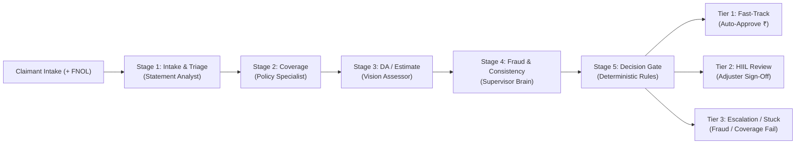

# Spark Cockpit · Autonomous Multi-Agent FNOL Claims Triage Engine

[](https://fastapi.tiangolo.com)
[](https://crewai.com)
[](https://ai.google.dev)
[](https://tailwindcss.com)

**Spark Cockpit** is an enterprise-grade, automation-first First Notice of Loss (FNOL) claims triage engine. Built with **FastAPI**, **CrewAI**, and **Google Gemini 2.5 Flash / Flash-Lite Multimodal Vision**, it processes automotive accident claims end-to-end in **under 3 seconds**.

---

## 🌟 Key Highlights

* **Zero-Touch Straight-Through Processing (STP):** Instant approval and payout recommendations for Tier 1 minor claims ($\le$ ₹25,000).
* **Multimodal Visual AI Damage Inspection:** Scans physical vehicle damage photos zone-by-zone (bumper, hood, fender, headlight, wheel) without claimant bias.
* **Deterministic Contractual Gating:** Validates policy schedules against `db2_policies.json` for active date windows, vehicle registration match, deductibles, and Third-Party Only exclusions.
* **Autonomous 2-Loop Verification Engine:** Supervisor brain reconciles statements against visual evidence and live meteorological data (Open-Meteo API).
* **Live Adjuster Cockpit:** Single-Page Application (SPA) featuring live Kanban stage cards, dynamic HUD metrics, 1-click batch scenario feeder (1 to 7 presets), chat-based recommendation redrafting, and a fluid discard-to-dustbin animation.

---

## 🏗️ Architecture & Pipeline Flow



---

## 🤖 Specialized AI Agents

1. **Statement Analyst Specialist (`gemini-2.5-flash-lite`):** Extracts structured facts from claimant narratives, detects claimed impact zones, injuries, and third-party liabilities while protecting against prompt injection.
2. **Vision Assessor Specialist (`gemini-2.5-flash` Multimodal):** Conducts neutral pixel-level visual damage assessment, estimates parts and labor costs from standard pricing tables.
3. **Supervisor Brain & Verification Loop Orchestrator (`gemini-2.5-flash`):** Reconciles statement claims vs photographic evidence, coordinates targeted re-scan loops when contradictions appear, and checks live weather records.
4. **Policy & Coverage Specialist (`gemini-2.5-flash-lite` / Deterministic):** Enforces policy validity, coverage windows, deductibles, and exclusions.

---

## 🚀 Quickstart & Setup

### 1. Clone & Install Dependencies
```bash
git clone https://github.com/Shreesha1-ux/spark-fnol-multiagent.git
cd spark-fnol-multiagent

# Create and activate virtual environment
python -m venv venv
# Windows:
venv\Scripts\activate
# Linux/macOS:
source venv/bin/activate

pip install -r requirements.txt
```

### 2. Configure API Key
Create a `.env` file in the root directory:
```env
GEMINI_API_KEY=your_google_ai_studio_api_key_here
```

### 3. Start the Server
```bash
python -m uvicorn server:app --host 0.0.0.0 --port 8000 --reload
```

Open your browser at **`http://localhost:8000`** to access the Spark Cockpit.

---

## 🧪 Benchmark Test Scenarios

| Policy ID | Claimant | Vehicle | Scenario / Test Purpose |
| :--- | :--- | :--- | :--- |
| **`POL-1001`** | Arjun Mehta | Maruti Suzuki Swift Dzire | **Tier 1 Fast-Track:** Highway loose stone front bumper dent (Instant offer). |
| **`POL-1002`** | Priya Nair | Hyundai Creta | **Tier 2 Total Loss:** Severe cement mixer collision, crushed engine compartment. |
| **`POL-1003`** | Rajan Pillai | Honda City | **Tier 3 Fraud Gate:** Claimed head-on tree crash vs side wheel/fender only. |
| **`POL-1004`** | Sneha Kulkarni | Tata Motors Nexon | **Self-Correction Loop:** Basement pillar sideswipe scratch. |
| **`POL-1005`** | Vikram Sharma | Mahindra Scorpio-N | **Coverage Gap:** Highway guardrail collision (Third-Party Only policy). |
| **`POL-1006`** | Meena Iyer | Volkswagen Polo | **Expired Policy Gate:** Rear-end collision (Policy expired 10 days prior). |
| **`POL-1007`** | Aditya Reddy | BMW 3 Series | **High Reserve Sign-Off:** Outer Ring Road underbody damage (> ₹25k ceiling). |

---

## 🛡️ License

MIT License. Developed for automated insurance claims intelligence.
